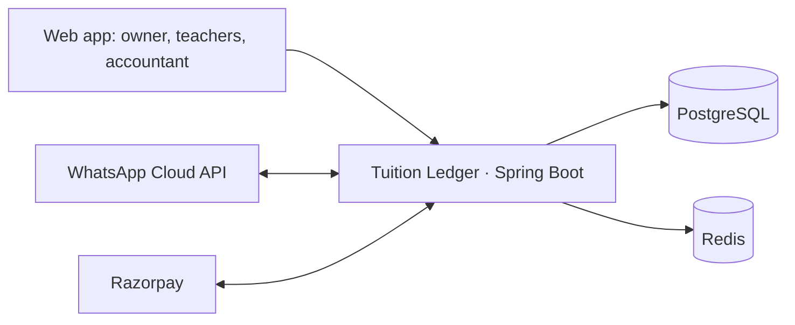

# 01 — Product requirements: Tuition Ledger

*Also maintained as a living doc: https://claude.ai/artifact/RxTRUvgtti9qERwdx8zEZT (same content; the doc is for client review and comments, this file is the repo's copy).*

## 1. The problem

Small coaching centres lose money and trust every month because fees, attendance and payments live in a register, a WhatsApp group and someone's memory, and none of the three agree. Tuition Ledger is the single record that makes them agree, with parents reached over WhatsApp and nothing for them to install.

### Worked example: Bright Minds Academy, Belur, September 2026

Bright Minds has 3 teachers, 7 batches, 118 students. Monthly fee is ₹1,200 for Class 8–10 batches and ₹1,800 for Class 11–12. Fees are due on the 5th. The owner, Mr Dutta, also teaches two batches; a part-time accountant comes on Saturdays.

**What should have happened in September:** 118 students × their fee = ₹1,71,600 billed; 9 students joined mid-month and owe a pro-rated amount; 4 left; 2 have sibling discounts of 10%. Correct collectable total: ₹1,66,140.

**What actually happened:**

| Day | Event | Consequence |
|---|---|---|
| 1–5 | Fees collected in cash by whichever teacher is present; UPI payments arrive to Mr Dutta's personal number with no note | 31 payments cannot be matched to a student with certainty |
| 6 | Accountant enters the week's cash from three teachers' notebooks | Riya (Class 9) is entered twice: once from Teacher A's notebook, once from Mr Dutta's, because she paid A and A handed the cash to Dutta |
| 9 | Mr Dutta posts "those who haven't paid, please pay" in all 7 groups | ₹0 collected; three parents who had paid reply angrily |
| 14 | Mother of Arjun (Class 11) asks whether he attended on the 10th and 12th | Teacher B counted heads that day; no answer possible; the mother concludes he skipped |
| 18 | A UPI payment of ₹1,200 arrives from an unknown number | Marked as "Riya, probably"; Riya is now paid three times on paper; her sibling Rohan, who actually paid, is still outstanding |
| 22 | The accountant computes ₹24,300 outstanding | Real figure is ₹37,800: the duplicates hid ₹13,500 of real dues |
| 30 | Four parents say they were charged for a full month although their child joined on the 19th | Mr Dutta refunds in cash to end the argument; the refunds are not written anywhere |

**Outcome for one month:** about ₹13,500 of dues never chased because the books said they were paid; ₹2,400 refunded without record; roughly 6 hours of the owner's time on reconciliation; two families who quietly moved to another centre after the group message. Across a year that is more than a teacher's salary.

### Why existing tools do not solve it

School ERPs are priced and designed for 1,000-student schools and need a computer operator. Generic ledgers track money but not attendance, batches or pro-rating, and do not talk to parents. Spreadsheets break at the first handover. The gap is a product built for 50–300 students where the parent side is WhatsApp and the owner side takes ten minutes a day.

## 2. Guarantees, users and roles

| # | Guarantee | Failure it prevents | How it is enforced |
|---|---|---|---|
| G1 | A payment is recorded exactly once, whatever the channel | Riya counted three times | Idempotency key per payment with a unique constraint; duplicates return the original receipt |
| G2 | Balances are derived from charges and payments; nothing is overwritten; corrections are new entries with reason and author | Refunds with no record | Append-only student ledger; balance = sum of lines |
| G3 | Charges are correct for joins, leaves, pauses and discounts, pro-rated by calendar day | Full-month charge for a 19th joiner | One fee engine; output explainable per student |
| G4 | Parents never get a reminder for money already paid, never two for one charge, never outside 8 am–8 pm | Angry replies to the group message | Reminders generated from the live balance at send time, deduplicated per charge, quiet hours |
| G5 | Anyone can get a student's attendance for any day in one query, with who marked it and when | "Did Arjun attend on the 10th?" | Attendance per student per session with marker and timestamp; parent self-service over WhatsApp |
| G6 | No data is lost on phone change, teacher change or server restart mid-job | Books restart with every new accountant | Server-side state; outbox that resumes; tested backups |

| Actor | Who at Bright Minds | Surface | Can do |
|---|---|---|---|
| Owner | Mr Dutta | Web app | Everything |
| Teacher | Teachers A, B | Web app, limited | Attendance for own batches, record cash, see own batches' dues |
| Accountant | Saturday accountant | Web app, limited | Payments, ledgers, refunds, adjustments; no attendance or fee-plan changes |
| Parent / student | 118 families | WhatsApp only | Reminders, receipts, keyword replies, pay by link |
| Platform admin | Tuition Ledger staff | Platform console | Centres, health, usage, support sessions; no student or money detail |

Full permission matrix: 07-tenant-admin.md.

## 3. Scope

**MVP (sprints 1–4):** centre setup, including self-serve registration with an OTP-verified owner and a 30-day trial (ADR-0018); roles; batches and sessions; students with consent; attendance; fee engine with pro-ration, discounts, one-off charges; payments by cash, Razorpay link, manual UPI; student ledger with gap-free receipts; parent WhatsApp (opt-in, reminders ×3, receipts, weekly digest, keywords); dashboard; statement, outstanding list, CSV exports; platform console basics; batch announcements; session rescheduling; PDF receipt links; calendar feeds and teacher nudges; tests and marks with results sent to parents over WhatsApp.

**Sprint 5 and after:** platform billing and plan limits, CSV import, data deletion, Bengali templates; later: bank statement import, teacher payroll share, parent-initiated pause/leave, exam marks.

**Deliberately out of the MVP:** live online classes, chat, a parent app, multi-branch accounting, any storage of card or bank credentials. Later phases (15-roadmap.md) add admissions, homework and material, leave requests, expenses, accountant exports, QR check-in, PTM slots, multi-branch, referrals, vernacular UI, and a paid recorded-class library with a student portal; live classes and a parent app stay out.

## 4. Functional requirements

See 02-srs.md for the full list with acceptance criteria. Requirement IDs: CEN, BAT, ENR, STU, ATT, FEE, PAY, LED, MSG, RPT, PLT, NFR.

## 5. Parent conversations on WhatsApp

Parents see a business number named after the centre, never "Tuition Ledger". Every message is short, names the child, states one number, and says what to do.

- **Opt-in:** "Bright Minds Academy here. We will send fee reminders and receipts for Arjun on this number. Reply YES to confirm, or STOP to opt out."
- **Reminder (due day, +3, +7):** "Bright Minds Academy: fee for Arjun (Class 11 Physics) for October is ₹1,800, due 5 Oct. Pay here: rzp.io/l/bm-7k2a. Already paid? Reply RECEIPT. Questions? Reply HELP." Follow-ups change only the first word: "Reminder:" and "Final reminder:".
- **Receipt:** "Bright Minds Academy: received ₹1,800 for Arjun on 4 Oct (cash, receipt BM-2026-000412). Balance now ₹0. Thank you."
- **Digest (Sunday 10:00):** "Bright Minds Academy, week of 13–18 Oct: Arjun attended 5 of 6 Physics sessions; absent Wed 15 Oct. Reply ATTENDANCE for the full month."

- **Test result:** "Bright Minds Academy: Arjun scored 38/50 in Physics Unit Test 2 (14 Oct). Batch average 31/50. Reply RESULTS for recent results."
- **Monthly assessment (last day of month):** "Bright Minds Academy, October for Arjun: attended 22 of 24 sessions. Tests: Unit Test 2 38/50, Unit Test 3 41/50. Teacher's note: steady improvement in numericals; needs practice in optics. Reply RESULTS for details."
- **Opt-in wording** includes attendance and test results: "We will send fee reminders, receipts, attendance and test results for Arjun on this number. Reply YES to confirm, or STOP to opt out."

| Parent sends | They get |
|---|---|
| DUES | Balance per child with payment link |
| ATTENDANCE | This month's counts and absent dates per child |
| RECEIPT | Last three receipts |
| HELP | Centre phone and hours; forwarded to owner |
| RESULTS | Last three test results and the latest monthly assessment |
| STOP | Reminders off; receipts continue; owner notified |
| anything else | Forwarded to the owner's inbox |

Rules: live-balance check before send; one reminder per charge per slot; quiet hours 20:00–08:00; one message per parent for siblings; every message logged with delivery status; undeliverable numbers flagged to the owner.

## 6. Architecture summary

One Spring Boot 4 application (Java 21, Spring Modulith), PostgreSQL 16, Redis, on one VPS; React SPA; WhatsApp Cloud API and Razorpay as the two external services; Postgres outbox instead of a broker. Details: 03-system-design.md, 04-lld.md, adr/.

## 7. Data model summary

Eighteen tenant tables plus platform tables; money as bigint paise; append-only ledger; gap-free receipt counters; outbox. Full DDL: 05-data-model.md.

## 8. Core flows

Attendance (supersede, 7-day window), fee month (idempotent per student, resumable), payment (one transaction: payment, allocation, ledger line, receipt number, outbox row), reminders (slot dedupe, live balance at send). Sequence diagrams: 04-lld.md.

## 9. Running it for real users

Consent before messaging; STOP honoured; privacy notice; deletion with ledger retention; OTP rate limits; signed webhooks; no card data; VPS under ₹1,200/month at ten centres; alerts on outbox age, fee-run completion, reconciliation diff. Details: 11-security-privacy.md, 12-runbook.md.

## 10. Plan, pilot and pricing

Five two-week sprints; Gate 1 (end of sprint 2): September re-entered and the statement balances; Gate 2 (end of sprint 4): one live fee cycle, zero duplicate payments; Gate 3 (end of sprint 5): first paid invoice. Pricing: Free / Starter ₹199 / Standard ₹499 with student overage (08-saas-plans.md). Sprint detail: 09-sprint-plan.md.

## 11. What this project proves in a Java interview

Ten stories, each with code and a test: idempotent payments across three channels; derived balances with DB grants; a restartable fee job; 50-thread receipt-number test; reminders cancelled by a payment at 07:58; property-tested pro-ration; tenant isolation as a test; outbox resume after kill -9; why no Kafka; what the pilot broke (docs/mistakes.md).
