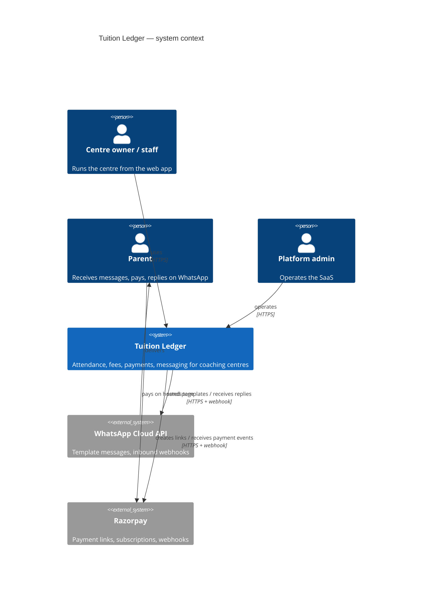
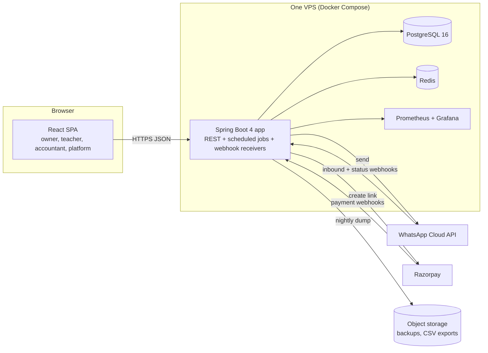
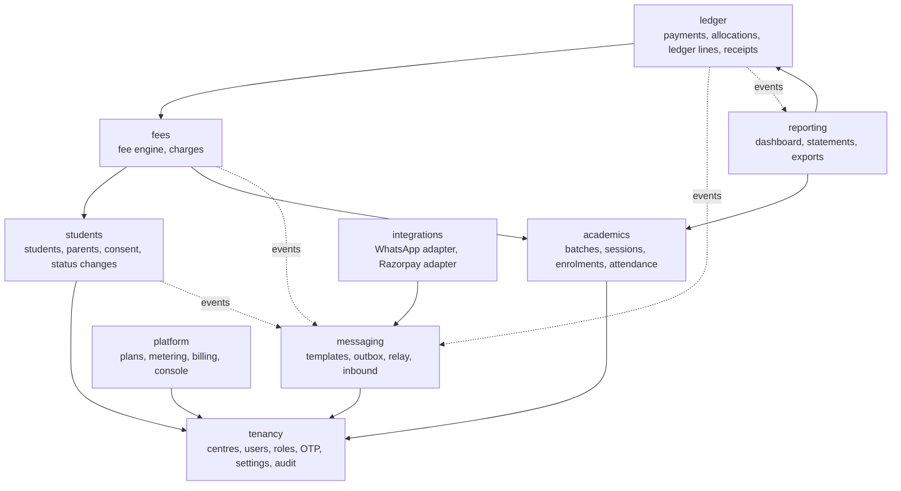

# 03 — System design (HLD)

## 1. Context

## 2. Containers

One application process. Scheduled jobs run inside it under ShedLock so a second replica can be added later without double-running jobs. No message broker (ADR-0003).

## 3. Modules (Spring Modulith)

Rules enforced by Modulith tests: a module may call another module only through its published API package; cross-module reactions (a payment triggers a receipt message) go through application events published in the same transaction and handled by `@ApplicationModuleListener`, which Modulith persists in its event publication registry so a crash between commit and handler does not lose the reaction.

| Module | Owns tables | Publishes events | Listens to |
|---|---|---|---|
| tenancy | centres, users, otp_challenges, settings, audit_log | UserDeactivated, SettingsChanged | — |
| academics | batches, sessions, enrolments, attendance | SessionMarked, EnrolmentChanged | HolidayAdded |
| students | students, status_changes, consents | StudentAdded, ConsentRecorded, StatusChanged | — |
| fees | charges | ChargeCreated, ChargeAdjusted | EnrolmentChanged, StatusChanged |
| ledger | payments, allocations, ledger_lines, receipt_counters, payment_links | PaymentRecorded, RefundRecorded | ChargeCreated (for allocation of credit) |
| messaging | outbox_messages, inbound_messages, message_templates | MessageDelivered, InboundReceived | PaymentRecorded, StudentAdded, SessionMarked |
| integrations | webhook_events | — | (adapters called by messaging and ledger) |
| reporting | mv_student_balances, statements | — | PaymentRecorded, ChargeCreated |
| platform | plans, subscriptions, usage, invoices_tl | PlanChanged, CentreSuspended | — |

## 4. Multi-tenancy

- One database, one schema; every tenant-owned table has `centre_id` (ADR-0002).
- The authenticated principal carries `centreId`; a request-scoped `TenantContext` sets a Hibernate filter `centre_id = :centreId` on every entity annotated `@TenantScoped`.
- Writes set `centre_id` from the context in a JPA `@PrePersist`; a mismatch throws.
- Postgres row-level security is enabled as a second line: the app sets `SET LOCAL app.centre_id` at transaction start and policies compare it. If the Hibernate filter is ever bypassed by a native query, RLS still blocks cross-tenant reads.
- A test scans the entity model: any entity with `centre_id` must carry `@TenantScoped`; any repository with a native query must be in the allow-list with a reviewed reason.
- With no tenant context, `app.centre_id` is null and every policy returns no rows (fails closed). The app connects as `tl_app`, which owns no table; `tl_migrate` owns the schema, because Postgres skips policies for the owner.
- Root tables (`centres`, `users`, `platform_admins`, `auth_tokens`) and platform tables (plans, subscriptions, usage, invoices_tl) have no row-level security. Root tables are reachable only through the tenancy module and platform tables only through the platform module (Modulith test); the platform API is reachable only by PLATFORM_ADMIN.
- A person is a global `users` row; their role at a centre is a `memberships` row, which is a tenant table (ADR-0020). Cross-centre jobs list `centres`, then process one centre per transaction with the context set to it.

## 5. Authentication and authorisation

- Phone + OTP (Redis-backed challenge, 5-minute TTL, 3 attempts, 5 sends per hour per phone).
- Access token: JWT, 15 minutes, claims {sub, centreId, role, ver}, for one centre. Sign-in identifies the person; with one active membership the token is issued for that centre, with several the SPA asks and calls `POST /auth/centre`; switching centre issues a new token. Platform admins get a token with `role = PLATFORM_ADMIN` and no `centreId`. Refresh token: opaque, 30 days, httpOnly cookie, rotated on use, stored hashed; `ver` bumps on role change or deactivation so old access tokens die within 15 minutes and refresh fails immediately.
- Authorisation: `@PreAuthorize` on application services using a permission enum (07 lists the matrix); TEACHER batch scoping is a query predicate, not a check in the UI.
- Webhooks: WhatsApp (X-Hub-Signature-256) verified against the per-environment app secret; Razorpay (X-Razorpay-Signature) arrives at `/webhooks/razorpay/{centreId}` and is verified against that centre's own webhook secret (ADR-0021). Both are verified before parsing and stored by provider event ID before processing.

## 6. Key runtime flows

See 04-lld.md for sequence diagrams. Summary of transaction boundaries:

| Action | One transaction contains | After commit |
|---|---|---|
| Record payment (any channel) | idempotency check, payment row, allocations, ledger line, receipt number, PaymentRecorded event | listener writes outbox row; relay sends receipt |
| Fee job per student | charge row, ledger line, ChargeCreated event | credit auto-allocation listener |
| Mark attendance | supersede old rows, insert new rows, SessionMarked event | digest aggregation |
| Reminder slot | select eligible charges; per charge: balance check, outbox row with dedupe key | relay re-checks balance, sends |
| Webhook receipt | insert webhook_events (unique), process, mark processed | — |

## 7. Scheduling

| Job | Cadence | Lock | Idempotency |
|---|---|---|---|
| Session generation | nightly 01:00 per centre | ShedLock `sessions-{centreId}` | unique (batch_id, starts_at) |
| Fee run | day 1, 00:10 centre time | ShedLock `fees-{centreId}-{period}` | unique (student, batch, period) |
| Reminder scan | every 15 min | ShedLock `reminders` | outbox dedupe key charge+slot |
| Digest | Sunday 10:00 centre time | ShedLock `digest-{centreId}-{week}` | dedupe key parent+week |
| Outbox relay | every 10 s | ShedLock `relay-{channel}` | provider message ID stored; row status |
| Teacher nudge | every minute, sessions starting in lead-time window | ShedLock `nudges` | outbox dedupe key session+user |
| Metering | day 1, 02:00 | ShedLock `metering-{period}` | unique (centre, period) |
| Reconciliation | nightly 03:00 | ShedLock | report only |
| Backup | nightly 02:30 | cron on host | — |

Centre-local schedules are implemented as a single minute-tick scheduler that selects centres whose local time matches, so 300 centres in 5 timezones need no per-centre cron.

## 8. Scaling path

| Signal | First response | Later |
|---|---|---|
| API p95 over target | add a second app replica behind Caddy; ShedLock already prevents double jobs | read replica for reporting |
| Relay backlog growing | relay batch size up, parallel channels | move outbox relay to Kafka connector (ADR-0003 documents the step) |
| Fee job over 10 min | parallelise per centre with a bounded thread pool | partition charges by period |
| Postgres over 70% CPU | indexes from 05, materialised balance view | managed Postgres, PgBouncer |
| 2,000+ centres | — | schema-per-large-tenant for the few that need it; the filter design allows a per-centre datasource later |

## 9. Observability

Micrometer metrics: `tl_outbox_pending`, `tl_outbox_oldest_age_seconds`, `tl_reminders_skipped_paid_total`, `tl_payments_idempotent_hits_total`, `tl_fee_run_duration_seconds{centre}`, `tl_webhook_signature_failures_total`, `tl_reconciliation_diff_paise`. Logs are JSON with `centreId`, `userId`, `requestId`. Traces via OpenTelemetry to a local Jaeger in dev. Alerts in 12-runbook.md.

## 10. Environments

| Env | Purpose | Data |
|---|---|---|
| local | Docker Compose, WhatsApp and Razorpay in sandbox/mock | seed script `make seed` creates Bright Minds with 118 students |
| staging | same VPS image, separate database, sandbox providers | anonymised copy of production |
| production | one VPS, managed backups | real |
