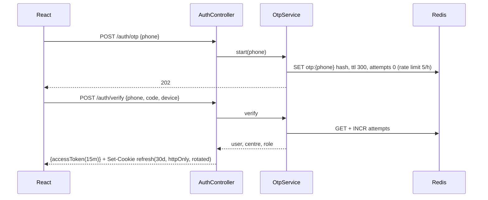
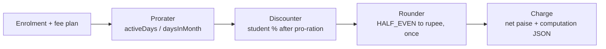
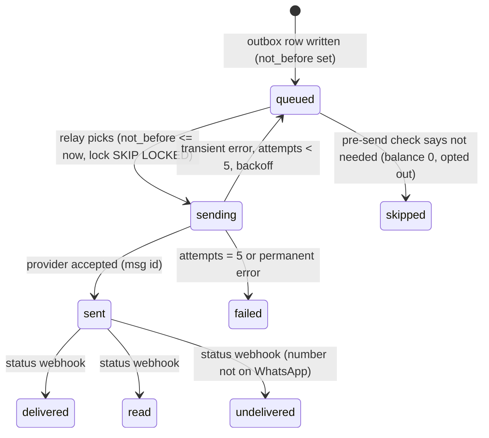

# 04 — Low-level design

Package root: `com.tuitionledger`. One package per module; `api` sub-package is the only one other modules may import.

```
com.tuitionledger
├── tenancy      {api, domain, application, infra, web}
├── academics    {api, domain, application, infra, web}
├── students     {...}
├── fees         {...}
├── ledger       {...}
├── messaging    {...}
├── integrations {whatsapp, razorpay}
├── reporting    {...}
├── platform     {...}
└── shared       {money, time, ids, errors, tenant}
```

Layering inside a module: `web` (controllers, DTOs) → `application` (services with `@Transactional` and `@PreAuthorize`) → `domain` (entities, value objects, domain services, no Spring) → `infra` (repositories, adapters). Controllers never touch repositories.

## 1. Shared kernel

```java
public record Money(long paise) {
  public static Money ofRupees(BigDecimal r) { return new Money(r.setScale(2, HALF_EVEN).movePointRight(2).longValueExact()); }
  public Money plus(Money o) { return new Money(Math.addExact(paise, o.paise)); }
  public Money negate() { return new Money(-paise); }
  public BigDecimal rupees() { return BigDecimal.valueOf(paise, 2); }
}
```
Rules: `Money` is the only money type outside the fee engine's BigDecimal pro-ration step. An ArchUnit test forbids `double`/`float` fields and parameters in any class whose name or package contains fee, charge, payment, ledger.

`TenantContext` (request-scoped, set by a filter from the JWT); `Ids` generates ULIDs (`stu_01J…`, `pay_01J…`) so IDs sort by time and are safe in URLs; `Clock` is injected everywhere and faked in tests; `CentreTime` converts between UTC instants and the centre's local calendar days.

## 2. tenancy

Entities: `Centre`, `User`, `Setting` (key/value with type and audit), `AuditEntry`.



`PermissionEvaluator` maps role → set of `Permission` (07). Services declare `@PreAuthorize("hasPermission(null, 'CHARGE_WRITE')")`. Teacher batch scoping: `BatchAccess.assertCanAccess(batchId)` reads `batches.teacher_id` and the role.

Audit: an AOP aspect on any application method annotated `@Audited(action = "SETTINGS_CHANGED")` writes `audit_log(centre_id, user_id, action, entity, before_json, after_json, at)`.

## 3. academics

Entities: `Batch` (with `Schedule` value object: set of `DayOfWeek` + `LocalTime` start/end), `Session`, `Enrolment`, `AttendanceMark`.

Session generation (`SessionGenerator.generate(centre, horizonDays)`): iterate days, for each batch active on that day create `Session(batchId, startsAt)`; `INSERT … ON CONFLICT DO NOTHING` on (batch_id, starts_at). Holidays: `centre_holidays` table; adding one deletes future unmarked sessions on that date.

Attendance (`AttendanceService.mark(sessionId, List<Mark>)`):
1. assert teacher owns batch or role ≥ OWNER;
2. assert session date within 7 days;
3. in one transaction: `UPDATE attendance SET superseded_by = :batchId WHERE session_id = ? AND superseded_by IS NULL`; insert new rows; publish `SessionMarked`.
Partial unique index: `(session_id, student_id) WHERE superseded_by IS NULL`.

## 4. students

Entities: `Student`, `Parent` (derived grouping by phone, not a table), `Consent`, `StatusChange`.

`StudentService.add` → saves, publishes `StudentAdded(studentId, parentPhone)`; messaging listener sends the opt-in template unless a consent already exists for that phone in that centre. `ConsentService.recordInbound("YES", phone)` writes consent for every student with that parent phone.

Status machine: `active → paused → active`, `active|paused → left`. Each transition is a `StatusChange(effectiveOn, reason, actorId)` and publishes `StatusChanged`, which the fee engine turns into an adjustment for the current period.

## 5. fees



```java
public final class FeeCalculator {
  public ChargeComputation monthly(Enrolment e, Student s, YearMonth period, ZoneId tz) {
    LocalDate start = max(e.from(), period.atDay(1)), end = min(e.toOrMax(), period.atEndOfMonth());
    int active = (int) ChronoUnit.DAYS.between(start, end) + 1, days = period.lengthOfMonth();
    BigDecimal gross = e.feeRupees().multiply(BigDecimal.valueOf(active)).divide(BigDecimal.valueOf(days), 6, HALF_EVEN);
    BigDecimal discount = gross.multiply(s.discountRate());
    Money net = Money.ofRupees(gross.subtract(discount).setScale(0, HALF_EVEN)); // the one rounding point
    return new ChargeComputation(net, gross, discount, active, days);
  }
}
```

`FeeRunJob.run(centreId, period)`: streams active enrolments in pages of 200; for each student, one transaction inserting the charge (`ON CONFLICT (student_id, batch_id, period) WHERE kind='monthly' DO NOTHING`) and its ledger line, publishing `ChargeCreated`. The job records progress in `fee_runs(centre_id, period, processed, total, status)` so the dashboard can show 60/118 and the job can be resumed.

Adjustments: `StatusChanged` and `EnrolmentChanged` listeners compute the delta between what was charged for the period and what the new facts imply, and insert a `kind='adjustment'` charge for the difference, positive or negative.

## 6. ledger

Entities: `Payment`, `Allocation`, `LedgerLine`, `ReceiptCounter`, `PaymentLink`.

```mermaid
sequenceDiagram
  participant C as Channel (web / webhook)
  participant PS as PaymentService
  participant DB as Postgres
  participant EV as Event bus
  C->>PS: record(cmd{studentId, amount, method, idemKey, extRef})
  PS->>DB: SELECT payment WHERE centre_id=? AND idempotency_key=?
  alt exists
    PS-->>C: existing receipt (200, Idempotent-Replay: true)
  else new
    PS->>DB: BEGIN
    PS->>DB: INSERT payment (unique idem key, unique ext ref)
    PS->>DB: SELECT next_no FROM receipt_counters WHERE centre_id=? FOR UPDATE; UPDATE next_no+1
    PS->>DB: INSERT allocations (oldest open charges first)
    PS->>DB: INSERT ledger_line(kind=payment, -amount)
    PS->>EV: publish PaymentRecorded (same tx)
    PS->>DB: COMMIT
    PS-->>C: receipt (201)
  end
```

Idempotency key sources: cash → client UUID sent by the SPA (generated when the form opens) plus server-side near-duplicate check (same student, amount, date in last 24 h → 409 unless `confirmDuplicate=true`); Razorpay → `payment.id`; manual UPI → UTR. All stored in `payments.idempotency_key`, unique per centre.

Allocation: `AllocationPolicy.oldestFirst(openCharges, amount)`; remaining amount becomes a credit ledger line with no charge; `ChargeCreated` listener applies existing credit to the new charge.

Refund: `RefundService.refund(paymentId, amount, reason)` inserts `ledger_line(kind=refund, +amount)` and, if Razorpay, calls the refund API with idempotency key `rf_{paymentId}_{n}`.

Balance: `SELECT COALESCE(SUM(amount_paise),0) FROM ledger_lines WHERE student_id=?`. A materialised view `mv_student_balances` is refreshed concurrently by the `PaymentRecorded`/`ChargeCreated` listeners (debounced 5 s per centre) and rebuilt nightly; reconciliation compares view vs sum.

## 7. messaging



`OutboxMessage{id, centreId, channel, recipient, templateKey, variables, dedupeKey, notBefore, attempts, status, providerMsgId, deliveryStatus}`. Unique partial index on `dedupe_key`.

Relay: every 10 s, `SELECT … WHERE status='queued' AND not_before<=now() ORDER BY not_before LIMIT 100 FOR UPDATE SKIP LOCKED`; for each, run `PreSendChecks` (balance still due for reminders; consent present; not opted out; within plan cap), then `WhatsAppClient.sendTemplate`. Provider failures map to transient (429, 5xx, timeout) or permanent (invalid number, template rejected).

Quiet hours: `notBefore = QuietHours.nextAllowed(now, centre)` at enqueue time, re-evaluated at send time.

Templates: `message_templates(key, language, provider_template_name, version, variables[])`; rendering is a pure function with snapshot tests; adding a language is a row, not code.

Inbound: webhook → `inbound_messages` → `InboundRouter` matches keyword (case- and whitespace-insensitive, Bengali synonyms list) → handler; unknown → `OwnerNotification`.

## 8. integrations

`WhatsAppClient` (interface) with `MetaCloudWhatsAppClient` and `FakeWhatsAppClient` (dev/test; records sends, can simulate delivery webhooks). `RazorpayClient` likewise with a fake. Both wrapped in Resilience4j: circuit breaker (50% failures over 20 calls opens for 60 s), time limiter 10 s, retry only on idempotent calls. Webhook controllers verify signatures, insert into `webhook_events` (unique provider+event_id → duplicate returns 200 immediately), then dispatch.

## 9. reporting

Dashboard queries read `mv_student_balances`, `charges`, `attendance` with centre-scoped indexes; all served under 100 ms on the seed dataset. Statements are generated on demand and cached per (centre, month) once the month is closed. CSV export streams rows; PDFs are out of MVP.

## 10. platform

`Plan{code, priceMonthlyPaise, includedStudents, overagePerStudentPaise, messageCap, features}`; `Subscription{centreId, plan, status(active|grace|readonly|cancelled), currentPeriodStart, razorpaySubscriptionId}`; `Usage{centreId, period, activeStudents, messagesSent, payments}`; `PlatformInvoice`.

`PlanGuard.check(centreId, Feature)` is called by application services for gated features (payment links, CSV import, extra teachers) and by `StudentService.add` for the student limit; it reads a cached plan snapshot (Redis, 60 s).

## 11. Error model

All errors return `{type, title, status, detail, instance, errors[]}` (RFC 9457). Domain errors map: `DuplicatePayment → 409 with the existing receipt in detail`, `PlanLimitExceeded → 402 with upgrade link`, `TenantMismatch → 404 (never 403, to avoid leaking existence)`, validation → 400 with field errors.

## 12. Frontend structure

React 18 + TypeScript + Vite; TanStack Query; generated client from `api/openapi.yaml`; routes per role; design tokens (one accent, one success green reserved for paid, amber for due, red for overdue; Inter + tabular numerals for money). Mobile-first: attendance marking, cash entry and the dashboard are designed at 360 px first.
