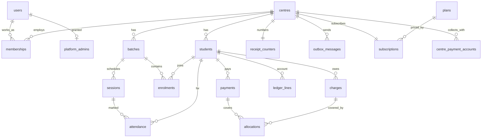

# 05 — Data model

PostgreSQL 16. Money columns are `bigint` paise. IDs are ULID strings with a type prefix. Every tenant table has `centre_id` and the composite index listed. Row-level security is enabled on tenant tables; root and platform tables have none and are reachable only through the tenancy and platform modules (ADR-0002). `tl_migrate` owns the schema and runs migrations; the app connects as `tl_app`, which owns nothing, so every policy applies to it.



## Root tables (no row-level security; tenancy module only)

```sql
CREATE EXTENSION IF NOT EXISTS citext;
CREATE TABLE centres (
  id text PRIMARY KEY, name text NOT NULL, address text, timezone text NOT NULL DEFAULT 'Asia/Kolkata',
  due_day smallint NOT NULL CHECK (due_day BETWEEN 1 AND 28), quiet_from time NOT NULL DEFAULT '20:00', quiet_to time NOT NULL DEFAULT '08:00',
  receipt_prefix text NOT NULL CHECK (receipt_prefix ~ '^[A-Z]{2,4}$'), whatsapp_sender_id text,
  whatsapp_status text NOT NULL DEFAULT 'not_connected' CHECK (whatsapp_status IN ('not_connected','pending','connected')),
  upi_id text CHECK (upi_id ~ '^[a-zA-Z0-9.\-_]{2,256}@[a-zA-Z]{2,64}$'), upi_payee_name text, -- parent fees by UPI go here (ADR-0021)
  signup_source text NOT NULL DEFAULT 'console' CHECK (signup_source IN ('console','self')), status text NOT NULL DEFAULT 'active',
  created_at timestamptz NOT NULL DEFAULT now());

-- A person, across every centre they work at (ADR-0020). No centre_id, no role.
CREATE TABLE users (
  id text PRIMARY KEY, phone text NOT NULL UNIQUE, name text NOT NULL,
  email citext UNIQUE, email_verified_at timestamptz, password_hash text, -- Argon2id; null = WhatsApp-code sign-in only
  failed_logins smallint NOT NULL DEFAULT 0, locked_until timestamptz,
  status text NOT NULL DEFAULT 'active', token_version int NOT NULL DEFAULT 0,
  created_at timestamptz NOT NULL DEFAULT now());

CREATE TABLE platform_admins (user_id text PRIMARY KEY REFERENCES users, granted_by text, granted_at timestamptz NOT NULL DEFAULT now());
CREATE TABLE auth_tokens (id bigserial PRIMARY KEY, user_id text NOT NULL REFERENCES users, kind text NOT NULL CHECK (kind IN ('email_verify','password_reset')), token_hash text NOT NULL UNIQUE, expires_at timestamptz NOT NULL, used_at timestamptz);
```

## Tenant tables

```sql
-- Where a person works and as what; one row per user per centre (ADR-0020).
CREATE TABLE memberships (
  user_id text NOT NULL REFERENCES users, centre_id text NOT NULL REFERENCES centres,
  role text NOT NULL CHECK (role IN ('OWNER','TEACHER','ACCOUNTANT')), status text NOT NULL DEFAULT 'active' CHECK (status IN ('active','deactivated')),
  invited_by text, created_at timestamptz NOT NULL DEFAULT now(), PRIMARY KEY (user_id, centre_id));
CREATE INDEX ON memberships (centre_id, status);

-- The centre's own Razorpay credentials (ADR-0021). Secrets are AES-GCM ciphertext; the key is not in the database.
CREATE TABLE centre_payment_accounts (
  centre_id text NOT NULL REFERENCES centres, provider text NOT NULL CHECK (provider IN ('razorpay')),
  auth_kind text NOT NULL CHECK (auth_kind IN ('api_key','oauth')), key_id text,
  secret_encrypted bytea NOT NULL, webhook_secret_encrypted bytea NOT NULL,
  status text NOT NULL DEFAULT 'connected' CHECK (status IN ('connected','invalid','disconnected')),
  updated_by text, updated_at timestamptz NOT NULL DEFAULT now(), PRIMARY KEY (centre_id, provider));

CREATE TABLE settings (centre_id text REFERENCES centres, key text, value jsonb NOT NULL, updated_by text, updated_at timestamptz NOT NULL DEFAULT now(), PRIMARY KEY (centre_id, key));
CREATE TABLE audit_log (id bigserial PRIMARY KEY, centre_id text NOT NULL, user_id text, action text NOT NULL, entity text, entity_id text, before_json jsonb, after_json jsonb, at timestamptz NOT NULL DEFAULT now());
CREATE INDEX ON audit_log (centre_id, at DESC);
CREATE TABLE centre_holidays (centre_id text REFERENCES centres, day date, reason text, PRIMARY KEY (centre_id, day));

CREATE TABLE batches (
  id text PRIMARY KEY, centre_id text NOT NULL REFERENCES centres, name text NOT NULL, subject text, class text, teacher_id text REFERENCES users,
  schedule jsonb NOT NULL, fee_paise bigint NOT NULL CHECK (fee_paise >= 0), capacity smallint, status text NOT NULL DEFAULT 'active');
CREATE INDEX ON batches (centre_id, status);

CREATE TABLE sessions (
  id text PRIMARY KEY, centre_id text NOT NULL, batch_id text NOT NULL REFERENCES batches, starts_at timestamptz NOT NULL, ends_at timestamptz NOT NULL,
  status text NOT NULL DEFAULT 'scheduled', cancel_reason text, UNIQUE (batch_id, starts_at));
CREATE INDEX ON sessions (centre_id, starts_at);

CREATE TABLE students (
  id text PRIMARY KEY, centre_id text NOT NULL REFERENCES centres, name text NOT NULL, class text, parent_name text, parent_phone text NOT NULL,
  joined_on date NOT NULL, discount_bps int NOT NULL DEFAULT 0 CHECK (discount_bps BETWEEN 0 AND 10000), status text NOT NULL DEFAULT 'active',
  deleted_at timestamptz, created_at timestamptz NOT NULL DEFAULT now());
CREATE INDEX ON students (centre_id, parent_phone);
CREATE INDEX ON students (centre_id, status);

CREATE TABLE consents (centre_id text, parent_phone text, recorded_at timestamptz NOT NULL, source text NOT NULL, PRIMARY KEY (centre_id, parent_phone));
CREATE TABLE opt_outs (centre_id text, parent_phone text, recorded_at timestamptz NOT NULL, PRIMARY KEY (centre_id, parent_phone));
CREATE TABLE status_changes (id bigserial PRIMARY KEY, centre_id text NOT NULL, student_id text NOT NULL REFERENCES students, status text NOT NULL, effective_on date NOT NULL, reason text, actor_id text, at timestamptz NOT NULL DEFAULT now());

CREATE EXTENSION IF NOT EXISTS btree_gist;
CREATE TABLE enrolments (
  id text PRIMARY KEY, centre_id text NOT NULL, student_id text NOT NULL REFERENCES students, batch_id text NOT NULL REFERENCES batches,
  from_date date NOT NULL, to_date date,
  EXCLUDE USING gist (batch_id WITH =, student_id WITH =, daterange(from_date, COALESCE(to_date, 'infinity'::date), '[]') WITH &&));
CREATE INDEX ON enrolments (centre_id, batch_id);

CREATE TABLE attendance (
  id bigserial PRIMARY KEY, centre_id text NOT NULL, session_id text NOT NULL REFERENCES sessions, student_id text NOT NULL REFERENCES students,
  mark char(1) NOT NULL CHECK (mark IN ('P','A','L')), marked_by text NOT NULL, marked_at timestamptz NOT NULL DEFAULT now(), superseded_by bigint);
CREATE UNIQUE INDEX attendance_current ON attendance (session_id, student_id) WHERE superseded_by IS NULL;
CREATE INDEX ON attendance (centre_id, student_id, marked_at);

CREATE TABLE tests (
  id text PRIMARY KEY, centre_id text NOT NULL, batch_id text NOT NULL REFERENCES batches, name text NOT NULL, held_on date NOT NULL,
  max_marks numeric(6,2) NOT NULL CHECK (max_marks > 0), topic text, created_by text NOT NULL, created_at timestamptz NOT NULL DEFAULT now(),
  results_sent_at timestamptz, results_sent_by text);
CREATE INDEX ON tests (centre_id, batch_id, held_on DESC);
CREATE TABLE marks (
  id bigserial PRIMARY KEY, centre_id text NOT NULL, test_id text NOT NULL REFERENCES tests, student_id text NOT NULL REFERENCES students,
  marks numeric(6,2) CHECK (marks >= 0), absent boolean NOT NULL DEFAULT false, entered_by text NOT NULL, entered_at timestamptz NOT NULL DEFAULT now(),
  superseded_by bigint, CHECK (absent OR marks IS NOT NULL));
CREATE UNIQUE INDEX marks_current ON marks (test_id, student_id) WHERE superseded_by IS NULL;
CREATE TABLE monthly_assessments (
  id text PRIMARY KEY, centre_id text NOT NULL, student_id text NOT NULL REFERENCES students, period char(7) NOT NULL,
  attendance_pct numeric(5,2), tests_json jsonb NOT NULL, comment text CHECK (char_length(comment) <= 200),
  status text NOT NULL DEFAULT 'draft', generated_at timestamptz, sent_at timestamptz, UNIQUE (student_id, period));
REVOKE UPDATE, DELETE ON marks FROM tl_app;

CREATE TABLE charges (
  id text PRIMARY KEY, centre_id text NOT NULL, student_id text NOT NULL REFERENCES students, batch_id text REFERENCES batches,
  period char(7) NOT NULL, kind text NOT NULL CHECK (kind IN ('monthly','one_off','adjustment')), description text,
  gross_paise bigint NOT NULL, discount_paise bigint NOT NULL DEFAULT 0, net_paise bigint NOT NULL, due_on date NOT NULL,
  computation jsonb, created_by text, created_at timestamptz NOT NULL DEFAULT now());
CREATE UNIQUE INDEX charges_monthly_once ON charges (student_id, batch_id, period) WHERE kind = 'monthly';
CREATE INDEX ON charges (centre_id, due_on);

CREATE TABLE fee_runs (centre_id text, period char(7), total int NOT NULL, processed int NOT NULL DEFAULT 0, status text NOT NULL, started_at timestamptz, finished_at timestamptz, PRIMARY KEY (centre_id, period));

CREATE TABLE receipt_counters (centre_id text PRIMARY KEY REFERENCES centres, next_no int NOT NULL DEFAULT 1);

CREATE TABLE payments (
  id text PRIMARY KEY, centre_id text NOT NULL, student_id text NOT NULL REFERENCES students, amount_paise bigint NOT NULL CHECK (amount_paise > 0),
  method text NOT NULL CHECK (method IN ('cash','upi_manual','razorpay')), idempotency_key text NOT NULL, external_ref text,
  received_on date NOT NULL, recorded_by text, receipt_no text NOT NULL, created_at timestamptz NOT NULL DEFAULT now(),
  UNIQUE (centre_id, idempotency_key), UNIQUE (centre_id, receipt_no));
CREATE UNIQUE INDEX payments_ext_ref ON payments (centre_id, external_ref) WHERE external_ref IS NOT NULL;
CREATE INDEX ON payments (centre_id, received_on);

CREATE TABLE allocations (payment_id text REFERENCES payments, charge_id text REFERENCES charges, amount_paise bigint NOT NULL CHECK (amount_paise > 0), PRIMARY KEY (payment_id, charge_id));

CREATE TABLE ledger_lines (
  id bigserial PRIMARY KEY, centre_id text NOT NULL, student_id text NOT NULL REFERENCES students,
  kind text NOT NULL CHECK (kind IN ('charge','payment','adjustment','refund','credit')), amount_paise bigint NOT NULL,
  ref_table text, ref_id text, reason text, actor_id text, created_at timestamptz NOT NULL DEFAULT now());
CREATE INDEX ON ledger_lines (centre_id, student_id, id);
REVOKE UPDATE, DELETE ON ledger_lines, charges, payments, audit_log FROM tl_app;

CREATE TABLE payment_links (id text PRIMARY KEY, centre_id text NOT NULL, student_id text NOT NULL, provider_link_id text UNIQUE, amount_paise bigint NOT NULL, short_url text, status text NOT NULL, created_at timestamptz NOT NULL DEFAULT now(), paid_at timestamptz);

CREATE TABLE message_templates (key text, language text, provider_template_name text NOT NULL, version int NOT NULL, variables text[] NOT NULL, PRIMARY KEY (key, language, version));

CREATE TABLE outbox_messages (
  id bigserial PRIMARY KEY, centre_id text NOT NULL, channel text NOT NULL DEFAULT 'whatsapp', recipient text NOT NULL, template_key text NOT NULL, language text NOT NULL,
  variables jsonb NOT NULL, dedupe_key text, not_before timestamptz NOT NULL DEFAULT now(), attempts smallint NOT NULL DEFAULT 0,
  status text NOT NULL DEFAULT 'queued', last_error text, -- queued | held (no WhatsApp sender yet) | sent | failed | skipped
  provider_msg_id text, delivery_status text, created_at timestamptz NOT NULL DEFAULT now(), sent_at timestamptz);
CREATE UNIQUE INDEX outbox_dedupe ON outbox_messages (dedupe_key) WHERE dedupe_key IS NOT NULL;
CREATE INDEX outbox_relay ON outbox_messages (status, not_before) WHERE status = 'queued';
CREATE INDEX ON outbox_messages (centre_id, created_at DESC);

CREATE TABLE calendar_feeds (user_id text REFERENCES users, centre_id text, PRIMARY KEY (user_id, centre_id), token_hash text NOT NULL UNIQUE, created_at timestamptz NOT NULL DEFAULT now(), revoked_at timestamptz, last_fetched_at timestamptz);
CREATE TABLE calendar_links (user_id text PRIMARY KEY REFERENCES users, provider text NOT NULL, refresh_token_enc text NOT NULL, calendar_id text, status text NOT NULL, connected_at timestamptz); -- Google sync, post-pilot

CREATE TABLE announcements (id text PRIMARY KEY, centre_id text NOT NULL, batch_id text REFERENCES batches, body text NOT NULL CHECK (char_length(body) <= 300), kind text NOT NULL DEFAULT 'manual', sent_by text NOT NULL, created_at timestamptz NOT NULL DEFAULT now(), recipients int);
CREATE TABLE session_changes (id bigserial PRIMARY KEY, centre_id text NOT NULL, session_id text NOT NULL REFERENCES sessions, old_starts_at timestamptz, new_starts_at timestamptz, reason text, actor_id text, at timestamptz NOT NULL DEFAULT now());
CREATE TABLE receipt_documents (payment_id text PRIMARY KEY REFERENCES payments, object_key text NOT NULL, token_hash text NOT NULL, expires_at timestamptz NOT NULL);

CREATE TABLE inbound_messages (id bigserial PRIMARY KEY, centre_id text, from_phone text NOT NULL, text text, provider_msg_id text UNIQUE, received_at timestamptz NOT NULL DEFAULT now(), handled_as text);
CREATE TABLE webhook_events (provider text, event_id text, payload jsonb NOT NULL, received_at timestamptz NOT NULL DEFAULT now(), processed_at timestamptz, PRIMARY KEY (provider, event_id));
```

## Platform tables (not tenant-scoped)

```sql
CREATE TABLE plans (code text PRIMARY KEY, name text, price_paise bigint NOT NULL, included_students int NOT NULL, overage_per_student_paise bigint NOT NULL, message_cap int NOT NULL, features text[] NOT NULL, active boolean NOT NULL DEFAULT true);
CREATE TABLE subscriptions (
  centre_id text PRIMARY KEY REFERENCES centres, plan_code text NOT NULL REFERENCES plans,
  status text NOT NULL CHECK (status IN ('trialing','active','past_due','read_only','suspended','cancelled')),
  trial_ends_on date, period_start date NOT NULL, grace_until date, razorpay_subscription_id text, updated_at timestamptz);
-- trialing → active (paid) or Free (under limits) or read_only at trial end; active → past_due (unpaid on the 7th) → read_only (14th) → suspended (60 days) (08 §3)
CREATE TABLE usage (centre_id text, period char(7), active_students int, messages_sent int, payments int, PRIMARY KEY (centre_id, period));
CREATE TABLE platform_invoices (id text PRIMARY KEY, centre_id text, period char(7), amount_paise bigint, status text, razorpay_ref text, created_at timestamptz);
```

## Materialised view

```sql
CREATE MATERIALIZED VIEW mv_student_balances AS
  SELECT centre_id, student_id, SUM(amount_paise) AS balance_paise, MAX(created_at) AS as_of
  FROM ledger_lines GROUP BY centre_id, student_id;
CREATE UNIQUE INDEX ON mv_student_balances (student_id);
```

## Row-level security

```sql
ALTER TABLE students ENABLE ROW LEVEL SECURITY;
CREATE POLICY tenant_isolation ON students USING (centre_id = current_setting('app.centre_id', true));
-- repeated for every tenant table by the migration generator
```
The app sets `SET LOCAL app.centre_id = '<id>'` in a `TransactionSynchronization` before any statement. With no context the setting is null and every policy returns no rows.

## Sign conventions

`ledger_lines.amount_paise`: charge and adjustment-up are positive (student owes more); payment, credit and adjustment-down are negative; refund is positive. Balance > 0 means the student owes; < 0 means credit.

## Retention

Outbox and inbound messages: 180 days then archived to object storage; audit log 7 years; everything else for the life of the centre plus 90 days after cancellation, then deleted on request or after 1 year.

## Phase 2–4 tables (outline; detailed before each phase)

enquiries, enquiry_events (admissions) · homework, materials, files (object storage keys, size, plan accounting) · leave_requests · expenses, expense_categories, recurring_expenses, teacher_payouts · pt_meetings, pt_slots · branches (centre_id, name, receipt_prefix) with branch_id added to users, batches, students · referrals · recordings (session_id, provider_asset_id, status, duration), recording_entitlements (student_id, period, source: paid|granted), recording_views · ui_translations keyed by locale.
