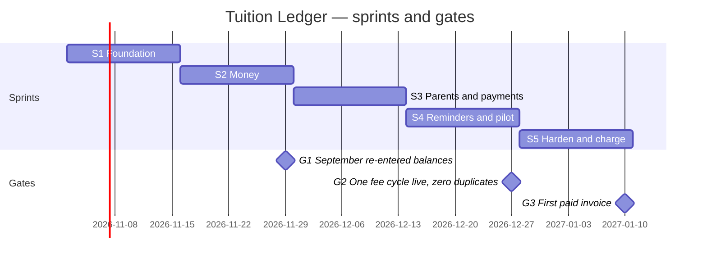

# 09 — Sprint plan and tickets

Five two-week sprints. Each ticket has an ID, a size in half-days (hd), the SRS requirement it satisfies, the LLD section to read, dependencies, and acceptance criteria. A ticket is Done when 13-ways-of-working.md's definition of done is met, including the tests named here. Owner roles: BE (backend), FE (frontend), QA, PM.

Capacity assumption: one backend developer (you), one part-time frontend developer, PM/QA shared. If you are alone, FE tickets move one sprint later and the pilot date moves two weeks; the cut line in 01-prd.md applies.



---

## Sprint 1 — Foundation (weeks 1–2)

**Goal.** A centre exists, staff can log in with OTP, batches and students are set up, and a teacher marks attendance on a phone. CI, Docker, backups and monitoring are in place from day one.

**Demo.** Create Bright Minds, invite Teacher A, create Physics Class 11, add 12 students, mark today's attendance from a phone, see it in the owner's view.

| ID | Ticket | Role | Size | SRS | LLD | Depends | Acceptance |
|---|---|---|---|---|---|---|---|
| S1-01 | Repo, Gradle (Kotlin DSL), Spring Boot 4.1, Modulith skeleton with 9 empty modules and the module-boundary test | BE | 1 hd | — | 04 §0 | — | `./gradlew test` passes `ModularityTests`; CI runs on push |
| S1-02 | Docker Compose: app, Postgres 16, Redis, Prometheus, Grafana, Mailpit-style WhatsApp fake UI | BE | 1 hd | — | 03 §2 | S1-01 | `make up` brings the stack; `/actuator/health` green |
| S1-03 | Flyway baseline with tenant tables from 05 (centres, users, settings, audit_log, batches, sessions, students, enrolments, attendance, holidays) incl. RLS policies and the `tl_app` role grants | BE | 2 hd | — | 05 | S1-01 | Migrations apply on empty DB and are idempotent; `REVOKE` verified by a test that tries an UPDATE on audit_log and fails |
| S1-04 | Shared kernel: `Money`, `Ids` (ULID), `Clock` bean, `TenantContext`, `CentreTime`, problem-details error handler | BE | 2 hd | NFR-7 | 04 §1, §11 | S1-01 | Unit tests; ArchUnit rule forbidding float/double in money packages |
| S1-05 | Tenancy: `Centre`, `User`, settings, OTP service (Redis), JWT + refresh rotation, `/auth/*`, `/me` | BE | 3 hd | CEN-1, CEN-2, CEN-4 | 04 §2 | S1-03, S1-04 | OTP expiry, 3-attempt lock, refresh rotation and reuse-detection tests; role change bumps token version |
| S1-06 | Authorisation: `Permission` enum, role matrix from 07, `@PreAuthorize` wiring, teacher batch scoping predicate, matrix-equality test | BE | 2 hd | CEN-3 | 04 §2, 07 §1 | S1-05 | Test table: every (role, permission) matches 07; a TEACHER on another teacher's batch gets 403 |
| S1-07 | Tenant isolation: Hibernate filter, `@TenantScoped`, `SET LOCAL app.centre_id`, entity-scan test, native-query allow-list | BE | 2 hd | NFR-8 | 03 §4 | S1-05 | Integration test: two centres, every repository call returns only own rows; RLS blocks a raw query |
| S1-08 | Academics: batches CRUD, schedule value object, session generation job with holidays, extra/cancel session | BE | 3 hd | BAT-1..3 | 04 §3 | S1-07 | Re-running generation creates no duplicates; holiday removes unmarked future sessions |
| S1-09 | Students: CRUD, E.164 validation, enrolments with exclusion constraint, status changes (events only; fee effect in S2) | BE | 2 hd | STU-1, ENR-1, ENR-2 | 04 §4 | S1-07 | Overlapping enrolment rejected; capacity override audited |
| S1-10 | Attendance: mark with supersede, 7-day window, month view query | BE | 2 hd | ATT-1, ATT-2 | 04 §3 | S1-08, S1-09 | Second save keeps history; day-8 edit refused with 409 |
| S1-11 | Audit aspect and `/audit` endpoint | BE | 1 hd | NFR-5 | 04 §2 | S1-05 | Settings change produces an audit row with before/after |
| S1-12 | Seed script: Bright Minds with 3 teachers, 7 batches, 118 students, 2 months of attendance | BE | 1 hd | — | 03 §10 | S1-10 | `make seed` runs in under 30 s |
| S1-13 | FE: project setup, generated client, auth screens (phone, OTP), app shell with role-based navigation, design tokens | FE | 3 hd | CEN-2 | 04 §12, ADR-0014 | S1-05 | Login on a 360 px viewport; token refresh transparent |
| S1-14 | FE: batches and students screens (list, create, edit, enrol) | FE | 3 hd | BAT-1, STU-1 | 06 | S1-13 | Forms validate E.164 and show server field errors |
| S1-15 | FE: attendance marking screen, phone-first (default present, tap to toggle, save, offline warning) | FE | 2 hd | ATT-1 | 06 | S1-13 | 40 students marked and saved in under 60 s by a tester |
| S1-16 | Ops: nightly `pg_dump` to object storage, restore script, Uptime Kuma, Grafana dashboard v0, alert to phone on health down | BE | 1 hd | NFR-4 | 12 | S1-02 | A restore into a fresh container is demonstrated and logged |
| S1-17 | QA: test plan matrix for sprint 1 scope; exploratory session on attendance | QA | 1 hd | — | 10 | S1-15 | Findings filed as issues with the bug-table format |

Sprint 1 total: BE 24 hd, FE 8 hd.

---

## Sprint 2 — Money (weeks 3–4)

**Goal.** The fee engine, charges, ledger, receipts and cash/UPI payments work and reconcile. Gate 1: September is re-entered from the register and the statement balances.

**Demo.** Run the fee job for September; record 40 cash payments and 10 UTRs including two deliberate duplicates; show the student ledger, receipt numbers 1–50 without gaps, and a statement that balances.

| ID | Ticket | Role | Size | SRS | LLD | Depends | Acceptance |
|---|---|---|---|---|---|---|---|
| S2-01 | Migrations: charges, fee_runs, receipt_counters, payments, allocations, ledger_lines, mv_student_balances, grants | BE | 1 hd | — | 05 | S1-03 | Applied; grants tested |
| S2-02 | `FeeCalculator` with pro-ration, discount, single rounding; `computation` JSON | BE | 2 hd | FEE-2, FEE-5 | 04 §5 | S1-04 | Unit tests for the SRS examples; jqwik properties: 0 ≤ net ≤ fee; splitting a month at any day sums to the full fee within ₹1 |
| S2-03 | Fee run job per centre with ShedLock, paging, per-student transactions, `fee_runs` progress, manual run/resume endpoint | BE | 3 hd | FEE-1, FEE-3 | 04 §5, 03 §7 | S2-02 | Run twice → same charge count; kill at 60/118 and resume → 118, no duplicates |
| S2-04 | Adjustments from `StatusChanged` and `EnrolmentChanged` (pause, leave, join mid-month, fee plan change next month) | BE | 2 hd | STU-2, FEE-6 | 04 §5 | S2-03 | Pause on 16th of 30-day month → −15/30 adjustment; fee change on 10th leaves current charges |
| S2-05 | One-off charges endpoint | BE | 0.5 hd | FEE-4 | 06 | S2-01 | Appears in ledger with description |
| S2-06 | Ledger module: `LedgerLine` append, balance query, materialised view refresh listener with debounce, sign conventions | BE | 2 hd | LED-1 | 04 §6 | S2-01 | Running balance test; view equals sum after refresh |
| S2-07 | `PaymentService.record` with idempotency key, near-duplicate check, receipt counter lock, oldest-first allocation, credit handling | BE | 3 hd | PAY-1, PAY-3, PAY-4, LED-2 | 04 §6, ADR-0006/7 | S2-06 | Replay returns same receipt; 50-thread test yields 1..50; UTR duplicate → 409 with original |
| S2-08 | Refund and reallocation endpoints with reasons | BE | 1 hd | PAY-5 | 04 §6 | S2-07 | Original rows unchanged; refund line referenced |
| S2-09 | Monthly statement query and reconciliation (opening + charges − payments ± adjustments = closing); nightly reconciliation job writing `tl_reconciliation_diff_paise` | BE | 2 hd | LED-3 | 04 §9 | S2-07 | Equation holds on seed data with all line kinds; metric exported |
| S2-10 | Modulith event publication registry configured (JDBC), incomplete-publication replay on startup | BE | 1 hd | — | ADR-0011 | S2-07 | Kill between commit and listener → listener runs on restart |
| S2-11 | FE: student page with ledger and running balance; charge explanation popover from `computation` | FE | 2 hd | LED-1, FEE-5 | 06 | S2-07 | Matches API totals |
| S2-12 | FE: record payment (cash, UTR) with client UUID idempotency key, near-duplicate confirmation dialog, receipt view | FE | 2 hd | PAY-1, PAY-3 | 06 | S2-07 | Double-tap creates one payment; dialog text matches 06 example |
| S2-13 | FE: fee run page (preview before the 1st, progress, resume), one-off charge form | FE | 1.5 hd | FEE-1 | 06 | S2-03 | Progress 60/118 visible during a run |
| S2-14 | Gate 1 exercise: re-enter September from Bright Minds' register with the accountant; log every discrepancy as a product note | PM, BE | 1 hd | — | 01 §10 | S2-12 | Statement balances; notes filed |

Sprint 2 total: BE 18.5 hd, FE 5.5 hd.

---

## Sprint 3 — Parents and payments (weeks 5–6)

**Goal.** Parents receive opt-in and receipts on WhatsApp, can reply with keywords, and can pay by Razorpay link; everything goes through the outbox.

**Demo.** Add a student → parent gets opt-in → replies YES → a cash payment produces a receipt message within a minute → a payment link is paid in the sandbox → webhook records it once even when replayed → parent replies DUES and gets the balance.

| ID | Ticket | Role | Size | SRS | LLD | Depends | Acceptance |
|---|---|---|---|---|---|---|---|
| S3-01 | Migrations: message_templates, outbox_messages, inbound_messages, webhook_events, consents, opt_outs, payment_links | BE | 0.5 hd | — | 05 | S2-01 | Applied |
| S3-02 | Messaging: templates table + renderer with snapshot tests; English templates for opt-in, receipt, reminder ×3, digest, keyword replies | BE | 2 hd | MSG-2, STU-3 | 04 §7, 01 §5 | S3-01 | Snapshots match 01 §5 wording |
| S3-03 | Outbox: enqueue API with dedupe key and not_before; relay with SKIP LOCKED, backoff, status transitions; PreSendChecks (consent, opt-out, plan cap stub) | BE | 3 hd | MSG-4, MSG-5, MSG-7 | 04 §7 | S3-02 | Kill relay mid-batch and restart → each row sent once; quiet hours shift not_before |
| S3-04 | WhatsApp adapter: Meta Cloud client with Resilience4j, fake client for dev/test, send + status webhook, inbound webhook with signature verification | BE | 3 hd | MSG-4, MSG-6 | 04 §8 | S3-03 | Bad signature → 401; status webhook updates delivery_status; fake simulates delivery |
| S3-05 | Consent flow: StudentAdded → opt-in (skip if consent exists for phone), YES → consents, STOP → opt_outs + owner notification | BE | 1.5 hd | STU-3, MSG-7 | 04 §4 | S3-04 | No reminder possible before consent (unit + integration) |
| S3-06 | Inbound router: DUES, ATTENDANCE, RECEIPT, HELP, unknown → owner notification; Bengali synonym list | BE | 2 hd | MSG-6, ATT-3 | 04 §7 | S3-04 | Reply content tests per keyword; unknown text appears in owner inbox |
| S3-07 | Receipt on PaymentRecorded (combined sibling handling not needed here), 60-second SLA metric | BE | 1 hd | MSG-2 | 04 §7 | S3-03 | Receipt row enqueued in the listener; timing metric |
| S3-08 | Razorpay adapter: create payment link, webhook `payment_link.paid` with signature, event store by event id, PaymentService call with provider payment id | BE | 3 hd | PAY-2 | 04 §8, ADR-0006 | S2-07 | Replayed webhook body → one payment; link status updated |
| S3-09 | Payment links endpoint with plan gate stub; link short URL in reminders | BE | 1 hd | PAY-2 | 06 | S3-08 | Link created in sandbox |
| S3-10 | Message log per student endpoint; owner inbox for forwarded replies | BE | 1 hd | MSG-6 | 06 | S3-06 | Log shows template, variables, status |
| S3-11 | FE: consent status on students (awaiting, given, opted out), resend opt-in, verbal consent with timestamp | FE | 1.5 hd | STU-3 | 06 | S3-05 | States visible and actionable |
| S3-12 | FE: payment link creation from student page and outstanding list; message log tab; owner inbox | FE | 2 hd | PAY-2, MSG-6 | 06 | S3-09, S3-10 | Link copied/shared; inbox reply box |
| S3-13 | Templates submitted to Meta for approval (PM task; 3–5 business days) | PM | 0.5 hd | MSG-2 | ADR-0010 | S3-02 | Approval IDs recorded in message_templates |
| S3-14 | Razorpay account KYC for the pilot centre started (PM task; takes a week) | PM | 0.5 hd | PAY-2 | 08 | — | Live keys available by sprint 4 |
| S3-16 | Batch announcements: endpoint, template, per-parent fan-out via outbox, log per student; auto-announce on session cancel | BE | 1 hd | ANN-1, ANN-2 | 04 §7 | S3-03 | Opt-out skipped; two batches → two messages |
| S3-17 | FE: announcement composer with recipient count and preview | FE | 0.5 hd | ANN-1 | 06 | S3-16 | Count matches API |
| S3-15 | QA: webhook replay, outbox crash, quiet hours, keyword matrix | QA | 1.5 hd | — | 10 | S3-08 | Cases executed; defects filed |

Sprint 3 total: BE 19 hd, FE 4 hd, PM 1 hd.

---

## Sprint 4 — Reminders, dashboard and pilot (weeks 7–8)

**Goal.** Reminders and digests run on schedule, the owner has a dashboard and reports, and Bright Minds runs its October fee cycle live. Gate 2: one full cycle with zero duplicate payments and every message traceable.

**Demo.** On the 1st the fee job runs with you present; reminders go out on the 5th at 08:00; a parent who paid at 07:58 gets no reminder; the outstanding list shows the rest; "send now" works once per day; the weekly digest arrives on Sunday.

| ID | Ticket | Role | Size | SRS | LLD | Depends | Acceptance |
|---|---|---|---|---|---|---|---|
| S4-01 | Reminder scheduler: slots from centre settings, per-charge dedupe key, live-balance check at enqueue and at send, sibling combination (one message per parent) | BE | 3 hd | MSG-1, MSG-8 | 04 §7, ADR-0008 | S3-03 | Pay at 07:58 → skipped row; two children → one message; second slot same day impossible |
| S4-02 | Weekly digest job per centre with disable setting; sibling combination | BE | 1.5 hd | MSG-3 | 04 §7 | S4-01 | No digest when disabled; content matches template |
| S4-03 | "Send reminder now" with 24-hour per-parent rate limit | BE | 0.5 hd | RPT-2 | 06 | S4-01 | Second call → 429 |
| S4-04 | Dashboard query set (due, collected, outstanding, rate, attendance per batch, today's sessions, awaiting consent) on mv + indexes; under 100 ms on seed | BE | 2 hd | RPT-1 | 04 §9 | S2-06 | Every figure matches SQL in the test |
| S4-05 | Outstanding list with days overdue and last reminder; CSV exports streaming | BE | 1.5 hd | RPT-2, RPT-3 | 06 | S4-04 | CSV opens correctly; 10k rows stream without OOM |
| S4-06 | Low-attendance flag job | BE | 0.5 hd | ATT-4 | 04 §3 | S1-10 | Flag appears next morning |
| S4-07 | Centre settings endpoints and audit for everything in 07 §2 | BE | 1.5 hd | CEN-1 | 07 | S1-11 | Each setting change audited and effective |
| S4-08 | Metrics and alerts: outbox backlog/age, reminders skipped, idempotent hits, fee run duration, webhook signature failures; Grafana dashboard v1; alert rules | BE | 1.5 hd | NFR | 03 §9, 12 | S3-03 | Alerts fire in a drill |
| S4-09 | FE: dashboard, outstanding list with send-now, reports page with statement and exports | FE | 3 hd | RPT-1..3 | 06 | S4-04 | Figures match API; phone layout |
| S4-10 | FE: settings area (all of 07 §2), audit log viewer, onboarding checklist | FE | 2.5 hd | CEN-1 | 07 | S4-07 | Checklist completes on the seed centre |
| S4-11 | Go-live runbook executed for Bright Minds: production env, live WhatsApp sender, Razorpay live keys, backups verified, owner and staff onboarded, opt-ins sent batch by batch | PM, BE | 2 hd | — | 12 | S4-01 | Checklist signed |
| S4-12 | Fee run on the 1st with the owner present; register kept in parallel as control | PM | 0.5 hd | — | 01 §10 | S4-11 | Run complete; discrepancies logged |
| S4-14 | iCal feed per user with signed token, revoke/rotate, deep link in event description | BE | 1.5 hd | CAL-1, CAL-2 | ADR-0015 | S1-08 | Subscribes in Google Calendar; link opens the session; revoked token → 404 |
| S4-15 | Teacher pre-session WhatsApp nudge via outbox (dedupe key session+user), cancelled when session cancelled or already marked | BE | 1 hd | CAL-3 | 04 §7 | S3-03 | Nudge timing and cancellation tests |
| S4-16 | FE: "Add to my calendar" page (feed URL, copy, rotate) and nudge settings | FE | 0.5 hd | CAL-4 | 07 §2 | S4-14 | Works on phone |
| S4-17 | Session reschedule action with history; nudges, feeds and auto-announcement follow the new time | BE | 1 hd | SCH-1, ANN-2 | 04 §3 | S4-14 | Feed and nudge tests at new time |
| S4-18 | Receipt PDF: HTML template, renderer, signed 90-day link in receipt message, object storage | BE | 1 hd | RCP-1 | 04 §9 | S3-07 | PDF totals equal ledger; expired link handled |
| S4-19 | FE: reschedule dialog; all-batches announcement with recipient preview | FE | 0.5 hd | SCH-1, ANN-3 | 06 | S4-17 | — |
| S4-13 | QA: reminder matrix (slots, quiet hours, paid-before-send, siblings, opt-out), dashboard figures, settings effects | QA | 2 hd | — | 10 | S4-09 | Executed; defects filed |

Sprint 4 total: BE 17 hd, FE 6.5 hd, PM 2.5 hd.

---

## Sprint 5 — Harden, platform and charge (weeks 9–10)

**Goal.** Fix what the pilot found, add the platform console and plan limits, meter usage, invoice the first centre. Gate 3: first paid invoice.

**Demo.** Platform console shows three centres with health; a Free centre hits 30 students and sees the upgrade prompt; Bright Minds' October usage row produces a ₹235 invoice; it is paid.

| ID | Ticket | Role | Size | SRS | LLD | Depends | Acceptance |
|---|---|---|---|---|---|---|---|
| S5-01 | Pilot fixes (reserved capacity; tickets created from docs/mistakes.md) | BE/FE | 6 hd | — | — | S4-12 | Each fix has a regression test |
| S5-02 | Platform module: plans, subscriptions, PlanGuard with Redis snapshot, limits in services and relay | BE | 2.5 hd | PLT-1, MSG-9 | 04 §10, ADR-0012 | S1-05 | 402s per 08 §2; message cap behaviour |
| S5-03 | Metering job and platform invoices; Razorpay subscription or link; grace → read-only → suspended transitions | BE | 2.5 hd | PLT-2, PLT-3 | 08 §3 | S5-02 | Usage row; invoice amount for Bright Minds = ₹235 + GST; read-only blocks writes |
| S5-04 | Platform console API (counts only) and support session (read-only, audited, 30 min) | BE | 1.5 hd | PLT-1 | 07 §5 | S5-02 | No student names in any console response (test) |
| S5-06 | Personal-data deletion endpoint and retention job | BE | 1 hd | STU-6 | 11 | S2-07 | Placeholders; ledger intact |
| S5-08 | Load test (k6): 300 centres × 150 students; fee job under 10 min; API p95 targets; fix hot spots | BE | 2 hd | NFR-1, NFR-2 | 03 §8 | S4-04 | Report committed to docs/perf |
| S5-09 | Restore drill and security pass (dependency scan, headers, rate limits, secrets scan) | BE | 1 hd | NFR-4 | 11, 12 | — | Drill logged; scan clean |
| S5-10 | FE: plan and usage page, upgrade/downgrade, read-only banner, platform console screens | FE | 3 hd | PLT-1..4 | 06, 07 §5 | S5-02 | Upgrade flow in sandbox |
| S5-11 | FE: CSV import wizard; data deletion confirmation; Bengali UI strings for messages preview | FE | 1.5 hd | STU-5, STU-6 | 06 | S5-05 | Preview shows row errors |
| S5-12 | Onboard two more centres; collect the first invoice; write the case study from the register-vs-system comparison | PM | 2 hd | — | 01 §10 | S5-03 | Invoice paid; case study in docs/ |
| S5-15 | Tests and marks: entities, append-only marks with supersede, 14-day window, teacher scoping | BE | 2 hd | ASM-1, ASM-2 | 04 §3 pattern | S1-10 | Marks history test; above-max rejected |
| S5-16 | Send results: per-child outbox rows, consent/opt-out checks, batch average setting, once-per-test guard, correction message | BE | 2 hd | ASM-3, ASM-4 | 04 §7 | S3-03 | Two children → two messages; resend → 409; correction → one parent |
| S5-17 | FE: test list, marks entry on phone (number pad, absent toggle, 40 students under 90 s), send-results confirmation | FE | 2.5 hd | ASM-1..3 | 06 | S5-15 | Usability check with a teacher |
| S5-18 | Templates: test result, corrected result, absent-for-test submitted to Meta | PM | 0.5 hd | ASM-3 | ADR-0016 | S3-13 | Approved before S5-16 ships |
| S5-14 | Start Google OAuth app verification (privacy policy URL, scope justification, demo video) so sync can ship in sprint 6 | PM | 1 hd | CAL-5 | ADR-0015 | — | Submitted; status tracked in 14-risks |
| S5-13 | QA: regression on all previous matrices; plan-limit matrix; platform console privacy check | QA | 2 hd | — | 10 | S5-10 | Executed; release notes |

Sprint 5 total: BE 20.5 hd (incl. 6 reserved), FE 7 hd, PM 3.5 hd. (CSV import and Bengali templates moved to sprint 6.)

---

## Post-pilot backlog (sprints 6–7, not committed; see 15-roadmap.md for phases 3 and 4)

| ID | Ticket | Role | Size | SRS |
|---|---|---|---|---|
| S6-01 | Google Calendar OAuth connect, token storage (encrypted), event push on session create/update/cancel | BE | 3 hd | CAL-5 |
| S6-02 | Free/busy check when creating batches or extra sessions; conflict warning; substitute suggestion | BE | 2 hd | CAL-5 |
| S6-03 | FE: connect/disconnect Google, conflict warnings in batch form | FE | 1.5 hd | CAL-5 |
| S6-04 | Bank statement CSV import and matching suggestions | BE | 3 hd | post-pilot |
| S6-05 | Teacher payroll share report | BE | 2 hd | post-pilot |

## Post-pilot backlog (sprints 6–7, not committed; see 15-roadmap.md)

| ID | Ticket | Role | Size | SRS |
|---|---|---|---|---|
| S7-01 | Admissions pipeline: enquiries, demo scheduling, follow-up nudges, convert to student, source report | BE | 4 hd | ADM-1..4 |
| S7-03 | Homework and material: files to object storage, signed links, keywords, storage cap | BE | 2.5 hd | HWK-1..2 |
| S7-05 | Parent LEAVE keyword and informed absence | BE | 2 hd | LVE-1..2 |
| S7-06 | Expenses, payouts, profit view | BE | 3 hd | EXP-1..3 |
| S7-08 | Accountant exports | BE | 3 hd | ACC-1..2 |

## Ticket template (copy into the tracker)

```
Title: <verb> <thing>  (e.g. "Record cash payment with idempotency key and near-duplicate confirmation")
Requirement: PAY-1  |  Design: 04-lld.md §6  |  ADRs: 0006, 0007
Context: one paragraph on why this exists, in the user's words
Scope: bullet list of what is included; "Out of scope" list
API: endpoints touched, with request/response examples or a link to 06
Data: tables/columns touched, migration number
Acceptance criteria: numbered, each testable, copied from 02-srs.md and refined
Tests required: unit / integration (Testcontainers) / contract / e2e, named
Observability: metrics or log fields added
Rollout: feature flag? data migration? downtime? none
Estimate: hd  |  Owner:  |  Depends on:
```

## Working agreements for sprints

- Sprint planning on day 1 (90 minutes): confirm capacity, pull tickets in dependency order, agree the demo.
- Daily 10-minute check-in; blockers go to the PM the same day.
- Mid-sprint review of the demo path with the pilot owner when relevant.
- Sprint review (demo to the client) and retrospective on the last day; retrospective actions become tickets.
- A ticket that grows beyond 3 hd is split; a ticket without acceptance criteria is not pulled.
