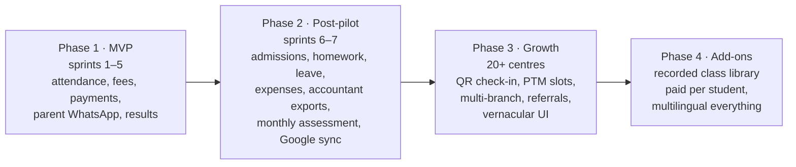

# 15 — Product roadmap beyond the MVP

The MVP (sprints 1–5) replaces the register and the group message for one centre. Everything below is decided scope for later phases, in order, so that nothing is re-argued when a centre asks for it. Each phase starts only when the previous one's exit criterion is met.

## Phase 1 — MVP (sprints 1–5). Exit: Gate 3, first paid invoice
Already specified in 02–09. Includes, added after the first draft: batch announcements (ANN-1..3), session rescheduling (SCH-1), receipt PDF link (RCP-1), calendar feeds and nudges (CAL-1..4), tests and results (ASM-1..4).

## Phase 2 — Post-pilot (sprints 6–7). Exit: three centres on two full cycles, churn 0

| Item | Why | SRS | Size |
|---|---|---|---|
| Monthly assessment with teacher comment | the message parents value most | ASM-5..8 | 6 hd |
| Admissions pipeline | enquiry → demo → follow-up → joined; grows the centre's revenue | ADM-1..4 | 6 hd |
| Homework and study material | PDF or photo per session, link to parents | HWK-1..2 | 4 hd |
| Parent leave requests over WhatsApp | LEAVE keyword; "informed absence" in digests | LVE-1..2 | 2 hd |
| Centre expenses and profit view | rent, payouts, materials; monthly profit line | EXP-1..3 | 5 hd |
| Accountant exports | Tally XML, Zoho CSV, GST-ready statement | ACC-1..2 | 3 hd |
| Google Calendar sync and conflict checks | Standard plan | CAL-5 | 6.5 hd |
| CSV student import, Bengali templates | moved from sprint 5 | STU-5, MSG-2 | 2.5 hd |
| Bank statement import and matching | accountant time saver | BNK-1 | 3 hd |
| Teacher payroll share | per batch or per student | PAYR-1 | 2 hd |

## Phase 3 — Growth (20+ centres). Exit: 50 centres, support load under 2 h/day

| Item | Why | SRS | Size |
|---|---|---|---|
| QR self check-in at the door | batches above ~40 students; teacher confirms exceptions | QR-1..2 | 5 hd |
| Parent–teacher meeting slots over WhatsApp | teacher publishes slots, parent replies with a number | PTM-1..2 | 4 hd |
| Multi-branch centres | consolidated reports, branch-level staff, one subscription | MB-1..3 | 10 hd |
| Referral programme | referrer and referee discounts, tracked | REF-1 | 3 hd |
| Vernacular staff UI (Bengali, Hindi) | teachers who do not read English | I18N-1 | 6 hd |

## Phase 4 — Add-ons. Exit: the add-on pays for its own infrastructure

| Item | Why | SRS | Size |
|---|---|---|---|
| Recorded class library (paid per student) | centres that record classes want to sell access; students revise; a new revenue line for the centre and for Tuition Ledger | VID-1..7 | 20 hd |
| Multilingual everything (UI, templates, PDFs, portal) | expansion beyond Bengal | I18N-2..3 | 8 hd |

### Recorded class library — how it works (ADR-0017)
- The centre uploads a recording against a session (phone upload or link from Google Drive/YouTube unlisted); the file is transcoded and streamed by a video provider, never served from our VPS.
- A student portal (phone + OTP for the student or parent) lists the student's batches and the recordings they are entitled to.
- Access is an add-on the centre sells: a monthly "Recordings" charge per student created by the fee engine like any other charge, so dues, reminders and receipts already work. The centre sets the price; Tuition Ledger charges the centre a platform fee per active viewer plus storage.
- Entitlement = paid recordings charge for the month, or the owner grants free access per student or batch.
- Playback via short-lived signed URLs, watermarked with the student's name, download disabled; no DRM.
- Out of scope for the add-on: live classes, chat, quizzes inside videos.

### Multilingual — scope
- Phase 1 already keeps message templates per language in the database (ADR-0010).
- I18N-1: staff UI strings externalised and translated (Bengali, Hindi), language per user.
- I18N-2: per-parent language (a parent may want Hindi while the centre runs in Bengali); templates selected per recipient.
- I18N-3: PDFs (receipts, statements) and the student portal in all supported languages.

## What stays out at every phase
Live online classes and a video conferencing product; a chat product between teachers and parents; a general-purpose LMS with quizzes and courseware; a parent app store app while WhatsApp delivers.
